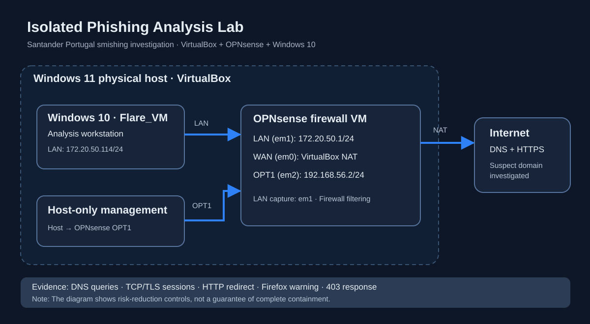
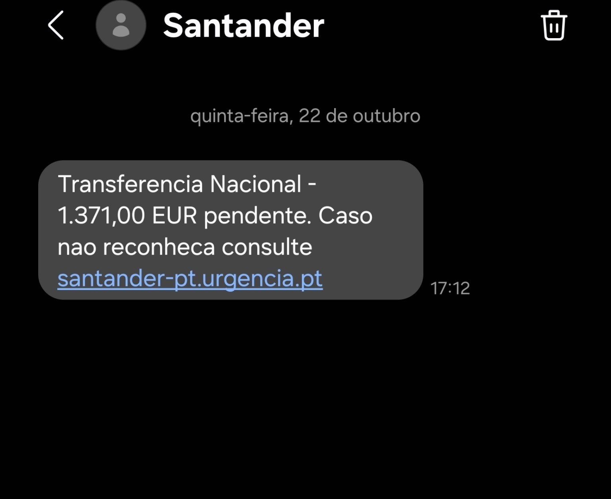
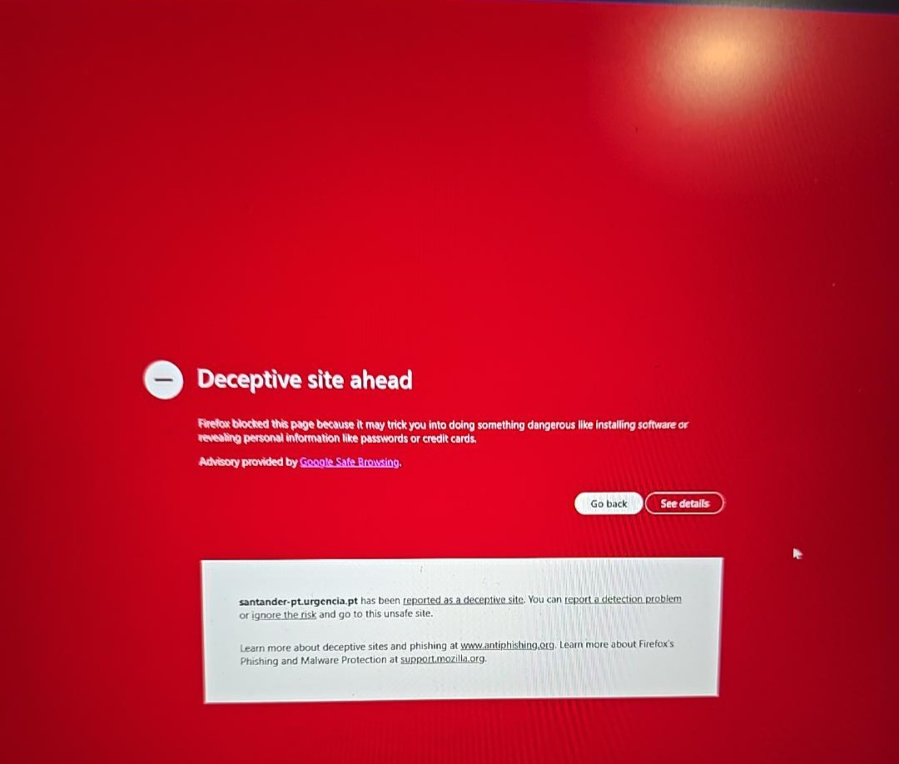
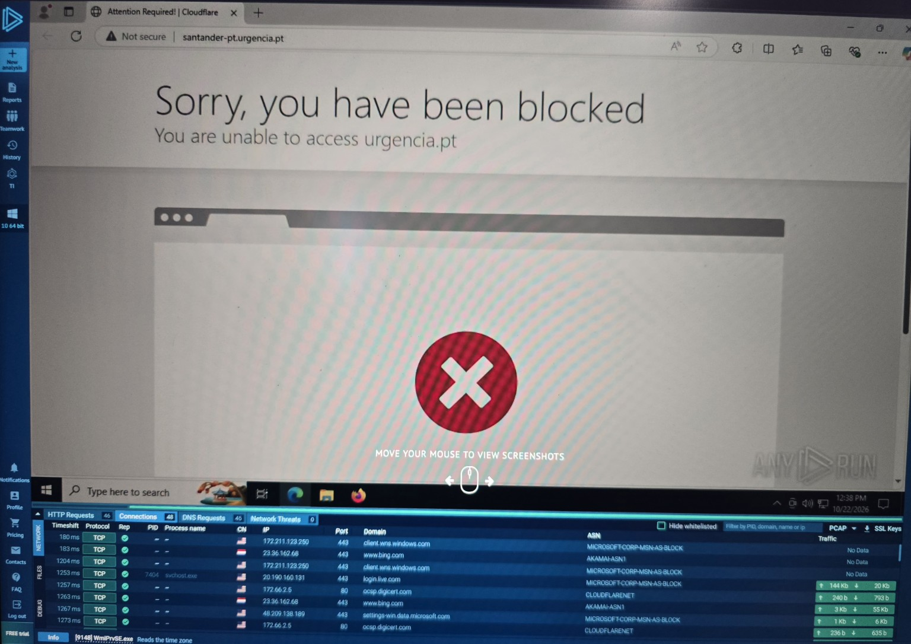

# Santander Portugal — Smishing Investigation

**Defensive cybersecurity case study** | SMS phishing triage · DNS · HTTP/TLS · Network forensics

> **Assessment:** Suspected phishing destination. A credential-harvesting page and credential exfiltration were **not confirmed**.

## Executive summary

This project documents the investigation of a suspicious SMS impersonating Santander Portugal and linking to `santander-pt[.]urgencia[.]pt`.

The investigation combined controlled browser checks, DNS queries and network packet capture from an isolated Windows 10 analysis VM behind OPNsense. Firefox displayed a **“Deceptive site ahead”** warning. When tested, the destination ultimately displayed **403 Forbidden**, rather than a visible banking login form.

The available captures establish DNS, TCP, HTTP and TLS activity, including a short HTTP-to-HTTPS redirect. They **do not** establish successful credential theft.

## Final assessment

**Classification: Suspected smishing / Santander Portugal impersonation — high confidence.**

The collected evidence strongly supports classifying the received SMS as a smishing attempt impersonating Santander Portugal. It invoked an allegedly pending **€1,371.00 domestic transfer** to create urgency and directed the recipient to a deceptive Santander-themed domain, `santander-pt[.]urgencia[.]pt`, rather than an official bank domain.

This assessment is supported by the original SMS, the Firefox **“Deceptive site ahead”** security warning, DNS and network observations from the isolated lab, and the Cloudflare access block observed in ANY.RUN.

**Important limits:** No credential-collection form was observed in the tested sessions. The available evidence does **not** establish that credentials were entered, stolen, or exfiltrated. The observed HTTP traffic did not show a credential-submission POST, but encrypted HTTPS traffic prevents ruling out all possible data exchange. The Cloudflare block does not establish why access was denied or whether the site was taken down.

**Conclusion:** The message is assessed as a **high-confidence smishing attempt**, while **successful credential harvesting and data exfiltration remain unconfirmed**. This distinction reflects the evidence available, not a lack of investigative value.

## Key findings

| Area | Observation | Limitation |
| --- | --- | --- |
| SMS | Santander branding and urgency | Social-engineering indicators, not proof of compromise |
| DNS | `santander-pt[.]urgencia[.]pt` resolved to `198[.]52[.]247[.]66` during testing | Historical observation; DNS can change |
| Browser | Firefox “Deceptive site ahead” warning | Browser reputation finding |
| HTTPS | `403 Forbidden` displayed | No working phishing form observed |
| HTTP | Redirect behaviour toward the HTTPS domain | Purpose of routing not confirmed |
| TLS | Handshake activity; curl certificate trust error | Full certificate chain not conclusively validated |
| Exfiltration | No credential submission found in visible HTTP traffic | HTTPS payloads were encrypted |

## Laboratory architecture

The diagram documents the Windows 11 host, Windows 10 Flare_VM, OPNsense LAN/WAN/OPT1 interfaces and outbound NAT path.

## Packet capture summary

| Capture | Total packets | TCP packets exchanged between analysis VM and observed remote IP |
| --- | ---: | ---: |
| Phishing_1 | 341 | 32 |
| Phishing_2 | 3,797 | 118 |

**Analysis VM:** `172.20.50.114` · **Observed remote IP:** `198[.]52[.]247[.]66` · **Capture interface:** OPNsense LAN `em1`.

## Repository navigation

- [Methodology and lab architecture](methodology.md)
- [Network analysis](network-analysis/README.md)
- [Indicators of compromise / investigation](iocs/indicators.md)
- [Evidence handling and publication policy](evidence/README.md)

## Conclusion

The suspicious SMS, deceptive-site browser warning and observed infrastructure behaviour justify treating the destination as **high-risk and suspected phishing-related**. The investigation did **not** recover a functioning credential-entry page or demonstrate credential exfiltration.

## Responsible disclosure and safety

This repository is for defensive research and education. No raw PCAPs or unredacted private evidence are published. Do not visit the suspicious URL outside a controlled environment or submit personal or banking information.

Santander Portugal is referenced solely as the impersonated brand. This project is not affiliated with Santander.

## Original smishing SMS

This user-received SMS initiated the investigation. It claimed that a €1,371.00 domestic transfer was pending and urged the recipient to visit a Santander-themed domain. The message is treated as **suspected impersonation**, not a genuine bank notification. The screenshot preserves the original evidence; suspicious destinations are defanged in the written analysis.

## Firefox phishing warning

Firefox displayed a **“Deceptive site ahead”** interstitial when the suspected smishing destination was visited in the isolated lab. This documents a browser security warning, not confirmation of a successful credential-harvesting page or data exfiltration.

## ANY.RUN screenshot

The captured browser session showed a Cloudflare access block; this does not confirm credential harvesting. See [ANY.RUN analysis](evidence/anyrun-analysis.md).
